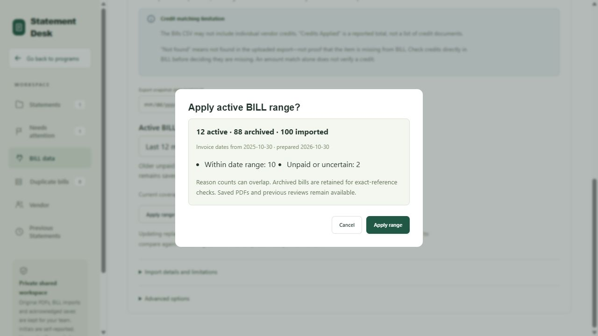

# AP active BILL range — local verification, 2026-10-30

Branch: `codex/ap-active-bill-range`, based on DD-v2 `33c6db5352bc0929e152fe5cb5a74eef052645ed`.

## Outcome and boundaries

The app prepares a derived active BILL index and full-history vendor context, defaults new updates to Last 12 months, and offers All imported dates. Existing sources change only after the prepared counts are accepted. Original exports/indexes, PDFs, revisions, duplicate scans and review events are retained. Daily Deposit code is unchanged. No shared database migration, deployment, activation, push, merge or reboot was performed for this feature.

A rolling year is evaluated from a frozen New York date. In this check, 2026-10-30 yields cutoff 2025-10-30. Older unpaid/uncertain, invalid/undated, non-invoice and saved unresolved follow-up evidence remains active. Archived absence is not full-export absence; an explicit exact-reference lookup is available. Missing credits in a Bills export remain an export limitation.

## Read-only representative export

The existing local normalized snapshot contained 223,425 records. Its file SHA-256 before/after was `3e94e39b975cd68b6ff6f7f47944e5495dcadf030668d5dd82fbb17c344964df`. Original CSV provenance from the existing analysis is `b496d270f619030d70e60f69fae47e75434987fa2e783b8ff8a646876f65891b`. No source bytes changed; no company record details or generated financial artifacts are included here.

| Coverage | Records |
| --- | ---: |
| Full source retained | 223,425 |
| Active before live saved protections | 24,884 |
| Outside active routine checks | 198,541 |
| Recent/future retention reason | 18,172 |
| Unsettled retention reason (overlaps recent) | 8,082 |
| Older retained exceptions | 6,712 |

These agree with the preliminary 24,884 analysis. No live saved follow-up data was fetched; actual protected coverage can be larger. Reasons overlap and must not be summed as unique rows.

All 7,865 required vendor/month profiles and 96,258 recurrence entries matched independent SQL calculations on full-source training inputs. Compact training input semantics also matched the full duplicate scanner in a direct parity regression, including repeated economic identities and source warnings.

A separate full-source scan emitted 465 pattern findings. All 237 full-source findings whose entire membership remains active were reproduced with equal classification and member fingerprints by the active scan. The remaining 228 findings involved excluded members and are outside the active scan's claimed coverage. Findings are review suggestions, not confirmed double payments.

## Local measurements

Windows, same Python environment and snapshot, single final representative run; filesystem/CPU contention can change these values. Times exclude network/Streamlit and are not production promises.

| Work | Measured time |
| --- | ---: |
| Initial derived active/context build | 57.000 s |
| Cold active/context semantic validation | 33.578 s |
| 100 warm exact-reference reads | 0.282 s |
| Full-source detector input preparation | 79.703 s |
| Full-source candidate phase | 71.766 s |
| Full-source input + candidate scan | 151.469 s |
| Active detector input preparation | 5.234 s |
| Active candidate phase | 14.328 s |
| Active input + candidate scan | 19.562 s |

Warm reads triggered no artifact download or full-source decompression. Active/context expanded sizes were 18,202,624 / 17,682,432 bytes; compressed sizes 2,353,695 / 3,385,883 bytes. Maximum cooperative build/cache step was 5.172 s; process peak RSS increase including the separate baseline scan was 125,800,448 bytes. Cooperative deadlines bound units between operations, not operating-system or network latency. Initial preparation still reads the full export and builds historical context.

## Release gates

- Frontend: `node --test tests/ap_statements*.test.mjs` — **454 passed, 0 failed**.
- Production asset build: `node app/ap_statements/build.mjs` — passed.
- Whitespace: `git diff --check` — passed.
- Backend: `$env:PYTHONPATH='tests'; python -X utf8 -m unittest discover -s tests -p 'test_*.py' -v` — **833 run: 832 passed, 1 skipped, 0 failed**, 1448.920 s. The skipped pre-existing `test_private_bucket_and_server_round_trip` explicitly reports: authorized synthetic Supabase project not configured; it remains a deployment blocker, not a passing live integration check.
- Synthetic active working-set scale: 223,425 last-12-months rows and 500,000 all-date rows passed unchanged size/memory/deadline limits; exact measurements below.

| Synthetic scale | Active | Build | Cold validation | 100 warm reads | Peak RSS increase | Max step |
| --- | ---: | ---: | ---: | ---: | ---: | ---: |
| 223,425 / last 12 months | 22,567 | 35.219 s | 17.312 s | 0.188 s | 32,612,352 B | 5.140 s |
| 500,000 / all dates | 500,000 | 154.438 s | 354.594 s | 0.172 s | 42,659,840 B | 5.203 s |

The 500,000-row expanded active/context total was 191,537,152 bytes, below the unchanged 512 MiB budget. Both cases verified original-byte immutability, context parity and warm no-download behavior. Small fixtures separately verify empty sets, protected exceptions, deterministic repeated artifact hashes, corruption rejection, and original ordinal mapping. Existing full-source duplicate release checks also passed at 223,425 and 500,000 rows, with repeat finding keys stable and original size/memory/work-step limits unchanged.

The first broad backend run detected one new scale failure: using a full DuplicateScan as a training scratch database exceeded 512 MiB at 500,000 records. Compact TrainingHistory removed unused evidence payload tables without raising limits. A direct full-scanner parity test and the final scale gates verify the replacement.

## Independent review and regression fixes

One independent whole-branch review reported three Important findings, no Critical or Minor findings. One fix pass reproduced each with failing tests, implemented corrections, and reran affected and full gates:

1. Startup/invoice preparation could erase a saved follow-up during protection refresh. Authoritative saved evidence now seeds compatibility checks across every refresh path. Resolved older rows retain previously reviewed same-export candidates if they leave the active range, with explicit provenance. Changed source/policy/input still invalidates incompatible decisions; human notes survive. The preservation guard revalidates the actually adopted export/policy even when another user updates it between freshness and adoption; the concurrent-export regression also ran RED→GREEN.
2. Saving an already-retained recent/open follow-up rebuilt the full export. Effective protections now bind only source namespaces otherwise excluded by the policy, while every saved change still advances the authoritative epoch. Equivalent retention reuses verified artifacts.
3. Protection collection ran synchronously over all revisions/members. Collection now resumes across requests with a shared deadline and bounded private pages, caches immutable revision-derived keys, and passes the shared deadline into duplicate evidence loading. Incomplete collection remains unavailable and cannot publish false absence.

Browser QA also found cancellation reporting success and an Apply confirmation blocked by the busy guard. Both had failing regressions before correction and were visibly rechecked.

## Synthetic browser QA and remaining rollout checks

Actual frontend modules/styles were served only on localhost with an in-memory synthetic client. Passed visibly: selector/default, unchanged existing range before Apply, prepared counts/cutoff, cancel, Apply, restore all dates, zero active coverage, dedicated invoice page/Back, explicit archived match disclosure, activation failure retaining acknowledged data, and same-operation retry. The original-PDF unavailable placeholder was checked. Original PDF rendering and immutable-history browser interactions were not exercised in this harness; their existing unit/integration tests are part of the release gates and deployed browser acceptance remains pending. No live financial decisions were saved.

Before production activation, run the [rollout checklist](../../ap-bill-working-range-rollout.md). True two-independent-connection PostgreSQL interleavings and deployed ACL behavior remain **unperformed**; local PGlite is single-connection. The migrations must be tested in a disposable synthetic project, then the owner must authorize and confirm the target production project. Save recovery definitions first. Keep v4-aware readers once scoped evidence exists; restore broad coverage using All imported dates rather than deleting history.

## Rulings made, in order

1. Use native PowerShell/Python bookkeeping instead of Bash-only skill helpers — Windows workflow follows the same briefs/BASE/RED-GREEN/commit ledger contract — risk is an omitted gate, mitigated by explicit logs and task completion records.
2. PGlite verifies serialized lifecycle/epoch conflicts and transaction rollback, but is a single-connection engine — retain true independent-session lock/interleaving as a dedicated synthetic-project rollout check, not a claimed local proof — cost is an unverified live concurrency behavior until that gate is run.
3. Consolidate the unchanged 223425/500000 detector release-scale rerun with Task 8 full release gates — existing detector code is unchanged in this task and focused original scan/profile/archive regressions ran now — cost is delayed scale-regression detection, covered before release.
4. Add guarded SQL restart and workspace working_protection_epoch — the planned wire restart and protection-refresh paths otherwise cannot recover lost local state or cheaply distinguish fresh protections — cost is two additional lifecycle checks, covered by SQL RED→GREEN regressions.
5. Add mappingDigest to the unshipped working-v1 contract and dispatch scoped scans as rules-v4/artifact-v3 while retaining unchanged full-source v3 behavior — this commits every active-to-original bill fingerprint mapping and preserves legacy evidence contracts — cost is an additional identity field and explicit dual-version paths, covered by mapping/projection/SQL tests.
6. Preserve saved statement decisions during protection-only refresh when original row evidence is identical; clear only incompatible decisions while retaining notes — otherwise saving a follow-up would immediately erase its local decision during the required scope refresh — cost is an evidence-compatibility comparison, covered by a RED→GREEN refresh regression.
7. Define protectionDigest from actual original vendor/reference/kind namespaces that would otherwise be archived under the frozen policy; retain the authoritative epoch for every saved change — recent/open/all-mode follow-ups do not affect membership and must reuse the verified set, while ambiguous vendors/Adventure aliases/amount discrepancies are still queried conservatively by exact reference — cost is indexed full-source lookup during a cold protection refresh, which yields until its archive is verified.
8. Independent-connection PostgreSQL interleavings and deployed ACL behavior remain explicit rollout gates — local PGlite lifecycle tests cannot prove real concurrent connections — cost is unverified deployment concurrency until a dedicated synthetic-project check is authorized and run.
9. The reviewer did not judge in-progress Task8 measurements/docs/full-suite outcome — the parent must complete those gates before claiming completion — cost is a misleading release claim if the pending gate is skipped; no production activation is authorized here.
10. Use compact TrainingHistory nodes for full-source profile/recurrence preparation rather than materializing unused full duplicate evidence tables — retained training semantics (normalized identity count, warning, first-row shape, vendor/ref/amount/day) remain identical, and 512 MiB caps stay unchanged — cost is a second ingest path, covered by direct full-scanner parity and both scale gates.
11. Keep previously reviewed candidates from the authoritative saved revision when a resolved older row leaves active coverage under the same immutable export, policy and mapping; label this retained evidence rather than claiming a new full-archive lookup — otherwise resolving a follow-up can immediately undo the decision — cost is retaining prior evidence until an explicit source/range/input change, covered by shrink and foreign-source/edited-row guards.
12. Browser QA uses synthetic local data and checks the original-PDF unavailable placeholder; original PDF rendering and immutable history were not exercised in that harness — existing unit/integration gates cover those paths, with live browser acceptance still listed before activation — cost is an unverified deployed visual/history interaction until rollout acceptance.

## Deferred minors

None. The independent review reported no Minor findings.
